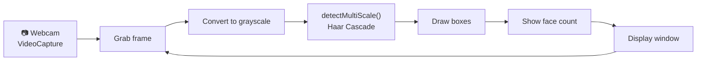

<div align="center">


# 👁️ Face Detection App

**Real-time face detection and counting from your webcam, in C++ with OpenCV.**

No GPU, no deep-learning model, no cloud. Just a Haar Cascade running locally.

<br />

[](https://isocpp.org/)
[](https://opencv.org/)
[](https://docs.opencv.org/4.x/db/d28/tutorial_cascade_classifier.html)
[](LICENSE)

<br />

[Demo](#-demo) •
[Features](#-features) •
[Quick Start](#-quick-start) •
[How It Works](#-how-it-works) •
[Tuning](#-tuning) •
[Troubleshooting](#-troubleshooting) •
[Roadmap](#-roadmap)

</div>

---

## 🎬 Demo

<!-- Replace with a real GIF: one face, then two faces, count changing on screen. -->
<div align="center">
  
</div>

## ✨ Features

| | Feature | Details |
|---|---|---|
| 📷 | **Live webcam feed** | Detects faces frame by frame in real time |
| 🟩 | **Bounding boxes** | A rectangle is drawn around every detected face |
| 🔢 | **Live face count** | The number of visible faces is shown on screen |
| 🪶 | **Lightweight** | Runs on CPU alone, with one small XML model |
| 🔒 | **Private by design** | Everything runs locally and no video leaves your machine |

## ⚡ Quick Start

### Prerequisites


- OpenCV 4.x
- A C++ compiler (GCC, Clang, or MSVC)
- A working webcam

### Install OpenCV

<details>
<summary><b>🐧 Ubuntu / Debian</b></summary>

```bash
sudo apt update
sudo apt install build-essential pkg-config libopencv-dev
```

</details>

<details>
<summary><b>🍎 macOS</b></summary>

```bash
brew install opencv pkg-config
```

</details>

<details>
<summary><b>🪟 Windows (Visual Studio)</b></summary>

1. Download OpenCV from [opencv.org/releases](https://opencv.org/releases/) and extract it.
2. Add the OpenCV `include` folder to your project's include paths.
3. Add the OpenCV `lib` folder to your library paths.
4. Link `opencv_world<version>.lib` (for example `opencv_world480.lib`, matching your version).
5. Copy the matching `opencv_world<version>.dll` next to your executable, or add OpenCV's `bin` folder to your `PATH`.
6. Build and run.

</details>

### Build and run

```bash
git clone https://github.com/<your-username>/face-detection-app.git
cd face-detection-app

g++ -std=c++17 test.cpp -o face_detection `pkg-config --cflags --libs opencv4`
./face_detection
```

> [!IMPORTANT]
> Run the app from the project folder so it can find `haarcascade_frontalface_default.xml`.

Press `Esc` or `q` to quit. *(Adjust to match your code.)*

### Choose your camera

The app opens camera index `1` by default. With a single webcam, change it to `0` in `test.cpp`:

```cpp
VideoCapture video(0);
```

> [!TIP]
> Built-in laptop webcams are usually index `0`. Index `1` is typically an external camera.

<details>
<summary><b>Build with CMake (optional)</b></summary>

Add this `CMakeLists.txt` to the project root:

```cmake
cmake_minimum_required(VERSION 3.10)
project(face_detection)

set(CMAKE_CXX_STANDARD 17)
find_package(OpenCV REQUIRED)

add_executable(face_detection test.cpp)
target_link_libraries(face_detection ${OpenCV_LIBS})
```

Then build:

```bash
cmake -B build
cmake --build build
./build/face_detection
```

</details>

## 🔍 How It Works



1. **Open** the webcam with `VideoCapture`.
2. **Load** the pre-trained Haar Cascade from `haarcascade_frontalface_default.xml`.
3. **Convert** each frame to grayscale, since the detector works on intensity.
4. **Detect** faces with `detectMultiScale()`, which scans the image at several scales.
5. **Draw** a rectangle around each face and show the total count.

<details>
<summary><b>What is a Haar Cascade?</b></summary>

A Haar Cascade is a classic machine-learning detector from Viola and Jones. It checks many small light/dark patterns across the image, and a chain of simple tests quickly rejects regions that clearly are not faces. That is why it is fast enough for real-time use on a CPU.

</details>

## 🎛️ Tuning

The two parameters that matter most in `detectMultiScale()`:

| Parameter | What it does | Raise it to... | Lower it to... |
|---|---|---|---|
| `scaleFactor` | Image shrink step between scans (e.g. `1.1`) | Run faster, but miss more faces | Catch more faces, but run slower |
| `minNeighbors` | Overlapping hits needed to confirm a face (e.g. `5`) | Cut false positives | Catch more faces, with more false hits |
| `minSize` | Smallest face to look for | Ignore small or distant faces | Detect smaller faces |

> [!TIP]
> Too many false boxes? Raise `minNeighbors`. Missing faces? Lower it, or lower `scaleFactor` slightly.

## ⚠️ Limitations

Haar Cascades are fast but dated, so expect these:

- Works best on **frontal faces**. Side profiles and tilted heads are often missed.
- Struggles in **low light** or strong backlighting.
- Can produce **false positives** on face-like patterns.
- Detects that a face is present. It does **not identify** who it is.

For better accuracy, see the roadmap.

## 📁 Project Structure

```text
face-detection-app/
├── test.cpp                              # Main application
├── haarcascade_frontalface_default.xml   # Pre-trained face model
├── docs/                                 # Banner and demo GIF
└── README.md
```

## 🛠️ Troubleshooting

| Problem | Fix |
|---|---|
| Black window or "camera not found" | Change the camera index from `1` to `0` |
| Cascade file fails to load | Run the app from the folder containing the `.xml` file |
| `opencv4` not found by pkg-config | Install the OpenCV dev packages (see above) |
| Camera is busy | Close other apps using the webcam (Zoom, browsers) |
| macOS: no camera access | Allow camera access for your terminal in System Settings → Privacy & Security → Camera |
| Windows: missing `opencv_world*.dll` | Copy the DLL next to the `.exe` or add OpenCV's `bin` folder to `PATH` |
| Laggy video | Raise `scaleFactor`, set a larger `minSize`, or downscale the frame before detecting |

## 🗺️ Roadmap

- [x] Real-time webcam detection
- [x] Bounding boxes and live face count
- [ ] Eye and smile detection
- [ ] Deep-learning detector (OpenCV DNN, e.g. YuNet)
- [ ] Save snapshots with a keypress
- [ ] Video recording
- [ ] CMake build and CI
- [ ] FPS counter overlay

## 🤝 Contributing

Contributions are welcome. Fork the repo, create a feature branch, and open a pull request.

```bash
git checkout -b feature/your-feature
git commit -m "Add your feature"
git push origin feature/your-feature
```

## 📄 License

Released under the [MIT License](LICENSE).

<div align="center">

<br />

Built with ❤️ using **C++ and OpenCV**

⭐ **Star the repo if you found it useful.**

</div>
